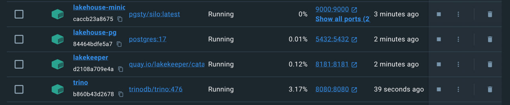
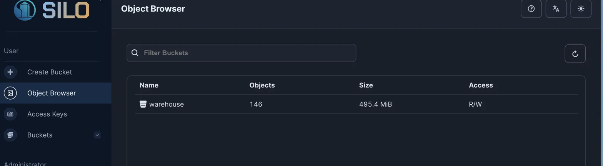
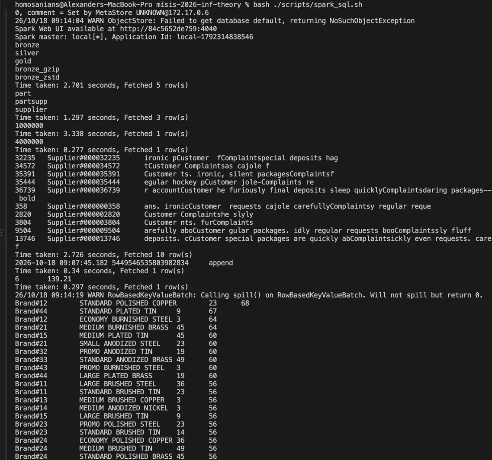

# Практическая №1 — Lakehouse: медальон для TPC-H Q16

Стек: **MinIO (Silo) → Lakekeeper (Iceberg REST Catalog, метаданные в PostgreSQL) → Trino**, дополнительно **Spark** для части 6.2.
Вариант 4 — **Q16 «Parts/Supplier Relationship»**, масштаб **sf5**.

> Цифры — из прогона на MacBook Pro (Apple M1 Pro), Docker Desktop. Скриншоты — в `screenshots/`.

## Как воспроизвести

```bash
./scripts/up.sh                                   # стек: MinIO, PostgreSQL, Lakekeeper, Trino
./scripts/run_sql.sh sql/00_check.sql             # каталоги видны, sf5 генерируется
./scripts/run_sql.sh sql/01_bronze.sql            # Bronze
./scripts/run_sql.sh sql/02_silver.sql            # Silver
./scripts/run_sql.sh sql/03_gold.sql              # Gold
./scripts/run_sql.sh sql/04_validate.sql          # Gold == исходный Q16
./scripts/run_sql.sh sql/05_layer_stats.sql       # цифры для раздела 4
./scripts/run_sql.sh sql/06_compression_bronze.sql && ./scripts/bench_compression.sh   # раздел 5
./scripts/run_sql.sh sql/09_schema_evolution.sql  # раздел 6.1
./scripts/time_travel.sh                          # раздел 6.1
./scripts/spark_sql.sh                            # раздел 6.2
```

Структура:

```
catalog/        lakekeeper.properties (Iceberg REST → MinIO), tpch.properties (генератор)
scripts/        up.sh, down.sh, run_sql.sh, bench_compression.sh, time_travel.sh, spark_sql.sh
sql/            00–10 — шаги работы по порядку, spark_bronze.sql — для Spark
spark/conf/     spark-defaults.conf (каталог lakekeeper для Spark)
results/        CSV с замерами, screenshots/ — скриншоты
```

---

## 1. Вариант и масштаб

| Поле | Значение |
|---|---|
| ФИО (как в VK Education) | Северюхина Полина Сергеевна |
| Вариант (запрос) | Q16 |
| Масштаб sfN | sf5 |
| Почему выбрал такой масштаб | На sf1 весь набор Q16 (part, partsupp, supplier) — несколько десятков МБ: запрос идёт доли секунды, и разница между кодеками тонет в шуме и кэше. sf5 (1 млн деталей, 4 млн связок деталь–поставщик, 50 тыс. поставщиков) даёт измеримые время и размер, но генерируется за минуты и помещается в память ноутбука, в отличие от sf10+. Данные `tpch.sfN` детерминированы, поэтому результат воспроизводим. Масштаб одинаковый на всех слоях. |

## 2. Поднятые сервисы — и почему именно они

Запущенные контейнеры (Docker Desktop):



Бакет `warehouse` в консоли MinIO (Silo): 146 объектов, 495,4 MiB — это сумма всех таблиц из разделов 4–5 (162,0 + 22,5 + 0,1 + 146,7 + 162,0 = 493,3 МБ) плюс метаданные Iceberg:



| Сервис | Роль в стеке | Почему именно он (а не альтернатива) |
|---|---|---|
| MinIO (образ `pgsty/silo` — свободный форк MinIO) | S3-совместимое объектное хранилище, сюда физически падают parquet-файлы | S3 API — стандарт де-факто: тот же код и конфиг Trino/Spark работают с AWS S3 или любым облачным S3 без изменений. Открытый исходный код, запускается одним контейнером. Форк Silo — потому что официальные образы MinIO больше не раздаются бесплатно, а API и переменные окружения те же. Альтернативы (HDFS, Ceph) тяжелее в развёртывании и избыточны для одной машины. |
| PostgreSQL 17 | БД, где Lakekeeper хранит метаданные каталога | Lakekeeper использует PostgreSQL как хранилище каталога. Транзакционная БД нужна, чтобы коммит Iceberg (атомарная замена указателя на текущий metadata.json) был атомарным даже при параллельной записи. Зрелая, открытая, стандартный образ. |
| Lakekeeper | Iceberg REST Catalog — каталог метаданных таблиц | Реализует открытую спецификацию Iceberg REST: Trino и Spark подключаются к одному каталогу и видят одни и те же таблицы без копирования (это показано в 6.2). Лёгкий: один бинарник на Rust плюс PostgreSQL. Hive Metastore требует JVM и не REST; Nessie даёт git-подобное версионирование каталога, которое здесь не нужно. |
| Trino 476 | SQL-движок: ходит в Lakekeeper за метаданными и читает/пишет данные в MinIO | Коннектор Iceberg с DML (CREATE TABLE AS, DELETE, INSERT, ALTER), time travel и системными таблицами `$files`/`$snapshots`/`$properties`. Встроенный коннектор `tpch` генерирует данные на лету — ничего не нужно скачивать. Интерактивный MPP-движок: запрос стартует за секунды, тогда как у Spark каждый запуск платит за старт JVM и SparkContext. |
| Spark 3.5.3 (вместо BI) | Второй движок для части 6.2: читает Bronze через тот же Lakekeeper | Подробно — в 6.2. Gold смотрится через Trino/DBeaver; отдельный BI не поднимался. |
| DBeaver | SQL-клиент к Trino (`jdbc:trino://localhost:8080/lakekeeper`) | Удобно смотреть таблицы и результаты; к работе стека не относится. |

### Скрипты, которыми поднимал стек

Полностью — [`scripts/up.sh`](scripts/up.sh) (идемпотентный: при повторном запуске просто стартует контейнеры). Суть:

```bash
# MinIO (Silo) — объектное хранилище, 9000 S3 API / 9001 консоль; бакет warehouse
docker run -d --name lakehouse-minio -p 9000:9000 -p 9001:9001 \
  -e MINIO_ROOT_USER=minioadmin -e MINIO_ROOT_PASSWORD=minioadmin \
  -v minio-data:/data pgsty/silo:latest server /data --console-address ":9001"
docker run --rm --entrypoint /bin/sh pgsty/mc:latest -c \
  "mc alias set m http://host.docker.internal:9000 minioadmin minioadmin && mc mb --ignore-existing m/warehouse"

# PostgreSQL — метаданные Lakekeeper
docker run -d --name lakehouse-pg -e POSTGRES_PASSWORD=postgres -p 5432:5432 \
  -v pg-data:/var/lib/postgresql/data postgres:17

# Lakekeeper — миграции БД, затем REST-каталог на 8181
docker run --rm -e LAKEKEEPER__PG_ENCRYPTION_KEY=... -e LAKEKEEPER__PG_DATABASE_URL_READ=... \
  -e LAKEKEEPER__PG_DATABASE_URL_WRITE=... quay.io/lakekeeper/catalog:latest-main migrate
docker run -d --name lakekeeper -p 8181:8181 -e ...(те же переменные) quay.io/lakekeeper/catalog:latest-main serve
curl -X POST localhost:8181/management/v1/bootstrap  -d '{"accept-terms-of-use": true}'   # Terms of Use
curl -X POST localhost:8181/management/v1/warehouse  -d @scripts/create-warehouse.json    # warehouse demo → бакет warehouse

# Trino — SQL-движок; catalog/ содержит lakekeeper.properties и tpch.properties
docker run -d --name trino -p 8080:8080 -v "$(pwd)/catalog:/etc/trino/catalog" trinodb/trino:476
```

## 3. Разбор запроса — какие данные нужны

| Таблица TPC-H | Нужные колонки | Что запрос с ними делает |
|---|---|---|
| part | partkey | джойн с partsupp |
| part | brand | фильтр `<> 'Brand#45'`, группировка, вывод |
| part | type | фильтр `NOT LIKE 'MEDIUM POLISHED%'`, группировка, вывод |
| part | size | фильтр `IN (49, 14, 23, 45, 19, 3, 36, 9)`, группировка, вывод |
| partsupp | partkey | джойн с part |
| partsupp | suppkey | исключение поставщиков `NOT IN (подзапрос)`, агрегат `count(DISTINCT)` |
| supplier | suppkey | вывод подзапроса (список исключаемых поставщиков) |
| supplier | comment | фильтр `LIKE '%Customer%Complaints%'` |

Остальные колонки (name, mfgr, container, retailprice, availqty, supplycost, адрес и т. п.) запросу не нужны.

## 4. Медальон — решения по каждому слою

Цифры — из [`sql/05_layer_stats.sql`](sql/05_layer_stats.sql); МБ = MiB, сумма `file_size_in_bytes` из `$files`.
Корректность проверена [`sql/04_validate.sql`](sql/04_validate.sql): Gold совпадает с исходным Q16 по `tpch.sf5` построчно: `gold_rows = ref_rows = 27 724`, `EXCEPT` в обе стороны = 0.

### Bronze (сырой)

| Таблица | Колонки (что оставил) | Строк | Вес, МБ | Формат | Сжатие | Партиционирование | Обоснование |
|---|---|---|---|---|---|---|---|
| bronze.part | все 9 | 1 000 000 | 20,3 (2 файла) | PARQUET | ZSTD | нет | Bronze — точная копия источника: из него можно пересобрать Silver под другой запрос без повторной генерации. Лишние колонки почти ничего не стоят при чтении — Parquet колоночный, и движок читает только нужные (для Q16 — 4 из 9). ZSTD: по замерам раздела 5 GZIP компактнее примерно на 9% (15 МБ на весь Bronze), но ZSTD быстрее читается в тёплом режиме; на таком объёме экономия места не важна, а Bronze читается при каждой пересборке Silver. Партиций нет: Q16 читает таблицу целиком, а партиции на таком объёме дали бы только мелкие файлы. |
| bronze.partsupp | все 5 | 4 000 000 | 139,2 (6 файлов) | PARQUET | ZSTD | нет | Самая большая таблица набора; аргументы те же. Фильтров по ней в Q16 нет (только джойн и `NOT IN`), поэтому партиционировать не по чему. |
| bronze.supplier | все 7 | 50 000 | 2,5 (1 файл) | PARQUET | ZSTD | нет | Маленький справочник, единицы МБ: один файл, партиции бессмысленны. |

### Silver (очищенный)

| Таблица | Колонки (что оставил) | Строк | Вес, МБ | Формат | Сжатие | Партиционирование | Обоснование |
|---|---|---|---|---|---|---|---|
| silver.part_supplier | partkey, suppkey, brand, type, size | 3 997 920 | 22,5 (50 файлов) | PARQUET | ZSTD | по `size` (50 партиций) | Один денормализованный факт «деталь — поставщик»: джойн partsupp ⋈ part сделан один раз, поставщики с жалобами исключены (минус 2 080 строк), лишние колонки отброшены — в основном за счёт этого, прежде всего текстового `comment`, Silver весит 22,5 МБ против 139,2 МБ у bronze.partsupp. Таблица переиспользуема для любых срезов «бренд/тип/размер × поставщики». Партиционирование по `size`: Q16 берёт 8 размеров из 50, Trino отсекает партиции и читает примерно 8/50 ≈ 16% данных (размеры распределены равномерно). Цена — 50 файлов вместо нескольких (около 80 тыс. строк на партицию, например size = 3 — 80 468 строк): это ещё не проблема мелких файлов. |

### Gold (витрина)

| Таблица | Колонки | Строк | Вес, МБ | Формат | Сжатие | Партиционирование | Обоснование |
|---|---|---|---|---|---|---|---|
| gold.q16_supplier_cnt | brand, type, size, supplier_cnt | 27 724 | 0,1 (1 файл) | PARQUET | ZSTD | нет | Готовый ответ на Q16: BI или аналитик читает его целиком без джойнов. Таблица маленькая (десятки тысяч строк), партиции не нужны. Порядок `ORDER BY supplier_cnt DESC, brand, type, size` задаётся при чтении — в Iceberg порядок строк в CTAS не гарантирован. |

## 5. Тесты производительности

Методика ([`scripts/bench_compression.sh`](scripts/bench_compression.sh)): Bronze пересоздан дважды — `bronze_gzip` и `bronze_zstd` ([`sql/06_compression_bronze.sql`](sql/06_compression_bronze.sql)), кодек подтверждён через `$properties`. Перед каждым кодеком перезапускаются Trino и MinIO (сброс кэша), затем Q16 по Bronze ([`sql/07_q16_on_bronze.sql`](sql/07_q16_on_bronze.sql)) прогоняется 1 раз холодным и 3 раза тёплым. Время — `exec_ms` из `system.runtime.queries` (без старта CLI); сырые цифры — `results/compression_runs.csv`.

| Сжатие на Bronze | Время запроса | Размер Bronze, МБ | Твой вывод (что лучше и почему) |
|---|---|---|---|
| GZIP | cold 3 889 мс; warm 1 348 / 913 / 824 мс (медиана 913) | 146,7 | GZIP компактнее: на 15,3 МБ (≈ 9%) меньше ZSTD. Холодный прогон у обоих одинаковый (разница 2% — в пределах шума): его определяют старт после рестарта и чтение метаданных, а не распаковка. |
| ZSTD | cold 3 958 мс; warm 1 459 / 810 / 758 мс (медиана 810) | 162,0 | В тёплом режиме ZSTD быстрее на ≈ 11% (810 против 913 мс) — это согласуется с тем, что распаковка ZSTD дешевле по CPU, чем GZIP. Итог: ZSTD — для часто читаемых слоёв, GZIP — для редко читаемых архивных данных, где важнее место. На sf5 обе разницы небольшие, по одной серии прогонов — однозначный вывод сделать нельзя. |

## 6. Часть 2 — осмысление и работа с инструментами

### 6.1. Понять и объяснить

| Вопрос | Ответ |
|---|---|
| Зачем нужны большие данные и lakehouse (а не обычная БД/хранилище)? | Обычная OLTP-БД хранит данные построчно на дисках одного сервера: аналитика по миллионам строк в ней медленная, а масштабирование дорогое. Классический DWH решает аналитику, но хранение и вычисления в нём связаны, а данные лежат в закрытом формате конкретного вендора. Lakehouse разделяет слои: данные лежат в дешёвом объектном хранилище (S3) в открытом колоночном формате (Parquet), над ними табличный формат Iceberg даёт то, что раньше было только в DWH: схему, ACID-коммиты, снапшоты и time travel, эволюцию схемы. Вычисления отдельны и сменяемы: одни и те же таблицы читают Trino и Spark (раздел 6.2), хранилище и движки масштабируются независимо. |
| Пример schema evolution на Silver: добавил/переименовал колонку — что произошло? | [`sql/09_schema_evolution.sql`](sql/09_schema_evolution.sql). `ADD COLUMN load_note varchar` — у всех существующих строк значение NULL; число файлов в `$files` и число снапшотов не изменились: Iceberg записал только новый metadata.json со схемой, parquet-файлы не переписывались. `RENAME COLUMN brand TO part_brand` — старые файлы сразу читаются под новым именем, потому что Iceberg сопоставляет колонки по внутреннему id, а не по имени. Фактически: до и после `ADD COLUMN` — 50 файлов и 1 снапшот; `load_note` = NULL у всех 3 997 920 строк; после переименования `part_brand` сразу читается из старых файлов (Brand#11 — 158 998 строк и т. д.). В конце схема возвращена к исходной. |
| Пример скрипта восстановления данных из снапшота (time travel) | [`scripts/time_travel.sh`](scripts/time_travel.sh) / [`sql/10_time_travel.sql`](sql/10_time_travel.sql): запоминаем `snapshot_id` из `"part_supplier$snapshots"` → `DELETE ... WHERE size = 3` (партиция «пропала») → `SELECT ... FOR VERSION AS OF <id>` показывает, что в старом снапшоте строки есть → `INSERT INTO part_supplier SELECT * FROM part_supplier FOR VERSION AS OF <id> WHERE size = 3` возвращает их. Фактически: в партиции `size = 3` было 80 468 строк → после DELETE 0 → в снапшоте `7591231986146290065` по-прежнему 80 468 → после INSERT снова 80 468. В `$snapshots` цепочка `append` (CTAS) → `delete` → `append` (восстановление), каждый снапшот ссылается на предыдущий через `parent_id`. |

### 6.2. Подключить инструмент к lakehouse

| Инструмент | Почему выбрал именно его |
|---|---|
| Apache Spark 3.5.3 (`spark-sql` + Iceberg runtime 1.7.1) | Главный batch/ETL-движок в индустрии, и он подключается к тому же REST-каталогу Lakekeeper: видит те же таблицы Bronze без экспорта и копирования. Это прямо показывает главное свойство lakehouse — хранение отделено от вычислений. Для моей задачи (пакетно построить слои и один аналитический запрос на одной машине) Spark проигрывает Trino по задержке из-за старта JVM и SparkContext, но выигрывает на больших объёмах и в распределённых ETL-пайплайнах. Doris/StarRocks — MPP OLAP-движки для быстрых дашбордов; они умеют читать Iceberg, но это отдельный кластер (FE + BE), тяжёлый для ноутбука, и для пакетного построения слоёв избыточный. |

Конфиг — [`spark/conf/spark-defaults.conf`](spark/conf/spark-defaults.conf) (каталог `lakekeeper`, warehouse `demo`, S3FileIO на MinIO). Запуск — [`scripts/spark_sql.sh`](scripts/spark_sql.sh) (сам скачивает jar-файлы Iceberg):

```bash
docker run -it --rm \
  -v "$(pwd)/spark/conf:/opt/spark/conf" \
  -v "$(pwd)/spark/jars:/opt/spark/iceberg-jars" \
  -v "$(pwd)/sql:/opt/spark/work" \
  apache/spark:3.5.3 /opt/spark/bin/spark-sql -f /opt/spark/work/spark_bronze.sql
```

Что делается в Spark ([`sql/spark_bronze.sql`](sql/spark_bronze.sql)): `SHOW NAMESPACES` / `SHOW TABLES IN lakekeeper.bronze`, `count(*)` по Bronze — те же числа, что в Trino; метаданные Iceberg (`.snapshots`, `.files`) из Spark; Q16 по Bronze на Spark.

| Движок | Q16 по Bronze (sf5) | Примечание |
|---|---|---|
| Trino | 810 мс (warm, медиана) | из раздела 5, `bronze_zstd` |
| Spark | 6,98 с | `Time taken` первого и единственного запуска Q16 в сессии `spark-sql` (`local[*]`) |

Результат Q16 в Spark совпал с Trino (первая строка `Brand#12 | STANDARD POLISHED COPPER | 23 | 68`); `count(*)` по `bronze.part` и `bronze.partsupp` — 1 000 000 и 4 000 000, как в Trino; из Spark видны схемы `bronze/silver/gold/bronze_gzip/bronze_zstd`, снапшот и файлы `bronze.partsupp` (6 файлов, 139,21 МБ — та же цифра, что в Trino). Сравнение времени не совсем честное: прогон Spark один и «холодный» по JVM, а у Trino взята медиана тёплых. Но порядок разницы (≈ 9 раз) показывает, что на одной машине и малом объёме Spark платит за накладные расходы.

Вывод `./scripts/spark_sql.sh`:



## 7. Выводы

Медальон разделил ответственность: Bronze хранит неизменённую копию источника и позволяет пересобрать всё ниже, Silver один раз выполняет джойн и очистку и становится переиспользуемым фактом, Gold — маленькая готовая витрина под конкретный вопрос (совпадение с исходным Q16 проверено: 27 724 строки, расхождений 0). Parquet выбран потому, что движки читают только нужные колонки; партиционирование оправдано только там, где фильтр отсекает большую часть данных (Silver по `size`), а на Bronze и Gold оно дало бы лишь мелкие файлы. По замерам GZIP на ≈ 9% компактнее, а ZSTD на ≈ 11% быстрее в тёплом чтении, поэтому для часто читаемых слоёв выбран ZSTD; Silver за счёт отбора колонок и строк получился в 6 раз легче исходного partsupp. Iceberg поверх S3 дал возможности DWH — эволюцию схемы без перезаписи файлов, откат через снапшоты и доступ к одним таблицам из Trino и Spark — при дешёвом открытом хранении.
